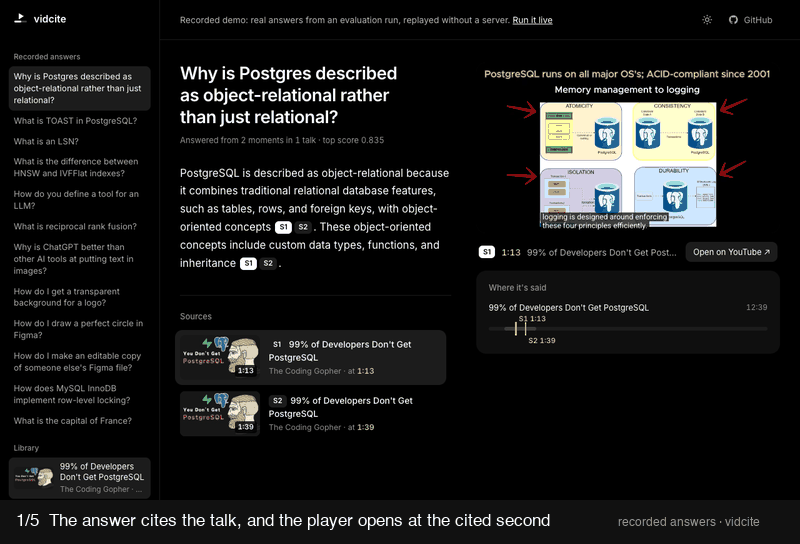
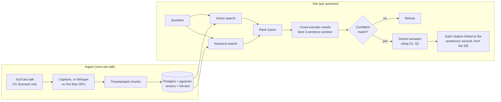
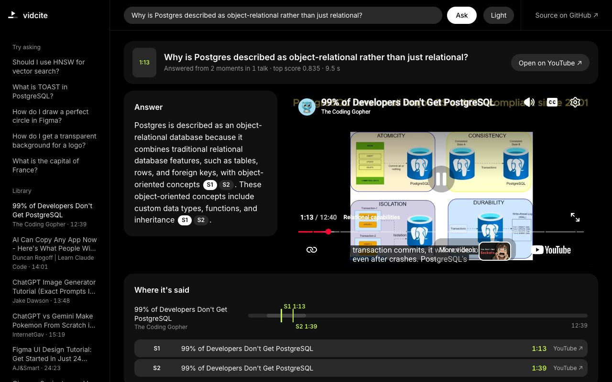

# vidcite

**Ask a question about long technical talks. Get a short answer whose citations jump the video to the exact second.**

[](https://github.com/NishithVadlamudi/vidcite/actions/workflows/tests.yml)
[](LICENSE)



**[Try the demo →](https://nishithvadlamudi.github.io/vidcite/)** · [How it works](#how-it-works) · [Results](#results) · [Decisions and what I measured](#decisions-and-what-i-measured) · [Run it yourself](#run-it-yourself)

*The demo replays real answers recorded during an eval run, so it needs no server or API key.*

## Results

Measured on a hand-labelled eval of 4 talks: 53 answerable questions with the second the answer is spoken, and
12 questions the talks don't cover, several of them deliberately near-topic.

| | Baseline | Now |
|---|---|---|
| Right passage ranked first (hit@1) | 64% | **85%** |
| Answers that cite the right moment | 50 / 53 | **52 / 53** |
| Citation links that land on time | 37% ¹ | **87%** |
| Off-topic questions refused instead of guessed | 12 / 12 | **12 / 12** |

¹ Before sentence-level links, on the first 2-talk eval. Baseline hit@1 is hybrid search before reranking;
plain vector search scored 59% on the 2-talk set. Full tables are in [Evaluate](#evaluate).

## How it works



- **Timestamps never come from the LLM.** The model only cites `[S1]`, `[S2]`; the second each tag jumps to is
  looked up from the stored transcript, at the sentence that best matches the cited claim.
- **Two retrievers, fused.** Vectors find paraphrases; Postgres full-text finds rare terms like "LSN" or
  "postmaster" that embeddings miss. Reciprocal rank fusion combines them, and a small cross-encoder reorders the top 10.
- **It says when it doesn't know.** A confidence gate and a NOT_FOUND rule in the prompt refuse off-topic
  questions; if the LLM is down, the app falls back to search results with timestamp links.
- **Stack:** Python, FastAPI, Supabase Postgres (pgvector HNSW + full-text), bge-small embeddings,
  MiniLM cross-encoder, Gemini 3.5 Flash-Lite, Whisper (mlx-whisper), a dependency-free HTML front end.

## Decisions and what I measured

Every change was checked against the eval, tuned on a dev split and reported on a holdout. The full log, with
dead ends, is in [`docs/first-run-notes.md`](docs/first-run-notes.md).

- **Hybrid search fixed rare terms.** Vector search alone missed questions about acronyms and internal names.
  Adding Postgres full-text search with rank fusion took hit@1 from 59% to 76% and hit@5 to 100% on the first set.
- **Linking to the sentence, not the chunk.** Links first pointed at the start of a ~230-word chunk, often a
  minute early: 37% on time. Estimating each sentence's time from its word offset (no schema change) plus an 8 s
  lead-in tuned on dev took that to 93%.
- **A result that was really a bug.** The first reranker run matched the baseline to the percentage point. Instead
  of concluding "reranking doesn't help", I checked the scores: every one was NaN, and sorting by NaN keeps the
  input order. The cause was a matrix multiply on memory-mapped weights; after the fix and a guard against
  non-finite scores, hit@1 went from 64% to 79%.
- **A general fix for one regression.** One question got worse with the reranker: its answer sat mid-way through a
  mixed-topic chunk and was diluted. Scoring each chunk by its best 3-sentence window fixed it and lifted the
  whole eval to 85% hit@1, with no losses.
- **Shipping negative results.** Merging adjacent chunks looked like a win (hit@1 76% → 93%) but the number was
  inflated by longer passages, and end to end it made links worse (93% → 83% on time), so it stays off. Whisper
  tied with free captions, so captions stay the default; Whisper is used only where captions lack punctuation or YouTube blocks them.
- **The eval overturned a tuning choice.** Dev data said to raise the similarity cutoff to 0.61. The holdout
  showed no gain, and the end-to-end run showed the prompt's NOT_FOUND rule, not the cutoff, was doing the refusing.
  The cutoff stayed at 0.55.
- **The GPU was 8× slower for one query.** A short query took 111 ms on the Mac GPU and 14 ms on CPU, because
  transfer and warm-up dominate. Queries moved to CPU (vectors verified identical); the GPU stays for batch ingest.

## Evaluate

`evals/questions.jsonl` holds hand-labelled questions: answerable ones carry the video
and the second the answer is spoken (looked up from caption word timings via a gold
phrase), and unanswerable ones (several deliberately near-topic) test abstention.
Every third question is a holdout: tune on dev, report on holdout.

```bash
python -m evals.run          # retrieval hit@1/hit@5/MRR, link accuracy, MIN_SCORE sweep (no LLM calls)
python -m evals.run --llm    # also end-to-end answers, citations and abstention (rate-limited;
                             # ~70-80 Gemini calls, free tier allows 500/day)
```

Results on 2 talks (29 answerable + 8 unanswerable, `gemini-3.5-flash-lite`):

| | Phase 3 | Phase 4 | Phase 4.1 |
|---|---|---|---|
| Retrieval | vector | hybrid (RRF) | hybrid + keyword gate |
| hit@1 / hit@5 / MRR | 59% / 93% / 0.74 | 76% / 100% / 0.87 | 76% / 100% / 0.87 |
| Answered / cited the gold moment | 90% / 86% | 93% / 93% | **100% / 100%** |
| Cited link on time (3 s late to 15 s early) | 37% | 93% | 93% |
| Abstained on unanswerable | 100% | 100% | 100% |
| p50 latency (warm) | 882 ms | 1,163 ms | 1,023 ms |

**Expanded eval (4 talks, 53 answerable + 12 unanswerable):**

| | Hybrid (Phase 4.1) | + cross-encoder reranker | + Whisper for Figma (`source=auto`) | + window (MaxP) reranking |
|---|---|---|---|---|
| hit@1 / hit@5 / MRR | 64% / 94% / 0.78 | 79% / 94% / 0.86 | 79% / 96% / 0.87 | **85% / 98% / 0.90** |
| Answered | 52/53 | 53/53 | 53/53 | 53/53 |
| Cited the gold moment | 50/53 | 50/53 | 51/53 | **52/53** |
| Cited link on time | 39/50 (78%) | 43/50 (86%) | 42/51 (82%) | **45/52 (87%)** |
| Unanswerable refused | 12/12 | 12/12 | 12/12 | 12/12 |

With multiple gold moments allowed where the talk justifies them (2 questions; see notes entry 18):
retrieval hit@5 **100%**, MRR 0.91, sentence links 83% on time.

**6 talks, 93 questions** (77 answerable + 16 unanswerable; two Whisper-only talks added): retrieval hit@1 77%,
hit@5 92%, MRR 0.83. The informal "ChatGPT vs Gemini Pokemon" commentary is by far the hardest talk (hit@5 67%).
End-to-end numbers for the 93-question set are pending: the run hit the Gemini free tier's 500 requests/day limit.

Per talk (before multi-gold): Postgres 17/17 gold citations, AI engineering 12/12, ChatGPT image tutorial 11/12,
Figma 12/12 (Whisper transcript) but only 7/12 links on time: mostly the 8 s lead-in plus answers that
start mid-sentence (tuned on lecture talks; a tutorial-specific value isn't supported by 12 questions yet).

- Retrieval fuses vector search with Postgres full-text search (reciprocal rank fusion;
  `HYBRID=0` turns it off).
- The confidence gate passes a question if the best cosine is at least `MIN_SCORE` *or* one
  chunk contains every content word of the question (recovers short acronym questions like
  "What is an LSN?"). The LLM's NOT_FOUND rule remains the safety net.
- `source=auto` (default): each video uses its Whisper transcript if you ran Whisper on it
  (`--source whisper`), otherwise its YouTube captions. Currently only the Figma tutorial (unpunctuated
  captions) uses Whisper.
- A cross-encoder (`cross-encoder/ms-marco-MiniLM-L-6-v2`, CPU, ~0.6 s per question) reranks the
  top 10 fused candidates, scoring each chunk by its best 3-sentence window so an answer in the middle
  of a mixed-topic chunk isn't diluted (`RERANK=0` disables it; `RERANK_MODEL=BAAI/bge-reranker-base` is ~2 points
  better on hit@1 but ~4x slower).
- Citation links jump to the sentence that best matches the cited claim, estimated from its
  word offset within the chunk, minus an 8 s lead-in tuned on the dev split.
- Measured and **left off**: merging adjacent chunks (`MERGE=1`) removes duplicate links but
  drops on-time links from 93% to 83%. Whisper transcripts (`--source whisper`) tie with YouTube
  captions on this set, so captions stay the default (Whisper is for videos without captions).

Analysis in `docs/first-run-notes.md`.

## Run it yourself

1. Install Python 3.11+ and ffmpeg (`brew install ffmpeg`).
2. `python -m venv .venv && source .venv/bin/activate`
3. `pip install -r requirements.txt`
4. In Supabase, open the SQL editor and run `db/schema.sql`.
5. Copy `.env.example` to `.env` and paste your Supabase connection string into `DATABASE_URL`.
6. Add your `GEMINI_API_KEY` to `.env` (free key from Google AI Studio).
7. `pytest` (all 73 tests should pass; no database or API key needed).

### Ingest videos

Find talks with YouTube's search filter: Filters > Features > Creative Commons.
Non-Creative-Commons videos are refused automatically.

```bash
# Fast path: YouTube captions, no transcription (minutes for a whole library)
python -m ingest.cli VIDEO_ID_1 VIDEO_ID_2 --source youtube

# Quality path: Whisper on the Mac GPU via mlx-whisper (slower, cached)
python -m ingest.cli VIDEO_ID_1 --source whisper
```

Each run saves chunks to `data/chunks/<video_id>.<source>.json`, embeds them on the
Mac GPU and stores them in Supabase. Both sources are kept side by side so the eval
can compare them. Add `--no-store` to stop after chunking (no database needed).

### Ask questions

```bash
# Web UI + API: open http://localhost:8000 (UI) or http://localhost:8000/docs (API)
uvicorn api.main:app --reload

# Or from the terminal
python -m api.ask_cli "How does Raft elect a leader?"
```



*The local web UI answering a live question (9.5 s, including a cold start of the models).*

The web UI (`api/static/index.html`, no build step or dependencies) shows the answer with its `[S1]` tags
as buttons that jump an embedded YouTube player to the cited second, the matching moments, and the talks
in the library. If the LLM is unavailable (e.g. the Gemini free-tier quota), `/ask` falls back to
**search only**: the best matching moments with timestamp links and no generated answer, still behind the
confidence gate.

**Voice:** in Chrome, Edge or Safari, the mic button next to Ask takes a spoken question, reads the answer
aloud, then plays the first cited moment. It uses the browser's own speech recognition and synthesis, so
nothing is installed; any click stops the reading. (Chrome sends the audio to Google for recognition.)

Each answer cites its sources as `[S1]`, `[S2]`; the CLI prints a YouTube link that
starts at the cited second. Timestamps come from the database, never from the LLM.
If the best match is too weak, or the model finds no answer, it says so instead of guessing.

## Recorded demo (GitHub Pages)

`docs/` is a static demo served by GitHub Pages: `python scripts/build_demo.py` copies 12 real answers
(with citations) from recorded eval runs into `docs/demo-data.json` and generates `docs/index.html` from the
live UI, so the two share styles and rendering code. No server, no API keys, no cost.

## Deploy (Hugging Face Spaces)

Note: Hugging Face now requires a paid plan for Docker Spaces (Static Spaces stay free), so this isn't
deployed; the recorded demo above is the free option. The `Dockerfile` also runs unchanged on other container
hosts (it was tested locally). The `Dockerfile` serves the web UI + API only (CPU torch, both models baked in, port 7860); ingestion
stays local. Public-demo limits are on in the image: 10 questions per visitor per hour and 150 generated
answers per day, after which `/ask` answers in search-only mode (`api/limits.py`).

1. Create a read-only database login: run `deploy/hf-space/readonly_role.sql` in Supabase's SQL editor
   (choose your own password).
2. Create a **Docker** Space (free CPU basic). In its settings add secrets `DATABASE_URL` (the read-only
   login) and `GEMINI_API_KEY` (ideally a key from a separate Google project, so the demo can't use your
   eval quota).
3. Commit, then `scripts/deploy_space.sh https://huggingface.co/spaces/<user>/vidcite`. It builds the Space
   from `HEAD` only, so `.env` and uncommitted files never leave your machine.

## Status

- [x] Schema
- [x] License-checked metadata, captions and audio download
- [x] Two transcript sources: YouTube captions (json3) and Whisper
- [x] Timestamp-aware chunker + tests
- [x] Ingestion CLI
- [x] Embedding (bge-small) + storage in Supabase
- [x] Phase 2: vector search, confidence gate, citation-tagged prompt, `/ask` API + CLI
- [x] Phase 3: eval set and metrics (`evals/`)
- [x] Phase 4: keyword search + rank fusion, sentence-level citation links
- [x] Phase 4.1: keyword gate, neighbour merging (measured, off), Whisper vs captions eval
- [x] Eval expanded to 4 talks / 65 questions; chunker fallback for unpunctuated captions
- [x] Cross-encoder reranking (on by default)
- [x] `source=auto`: Whisper where it was run (Figma), captions elsewhere
- [x] Local web UI with embedded player; search-only fallback when the LLM is unavailable
- [x] Two talks that YouTube blocked for captions ingested via Whisper (6 talks)
- [x] Gold questions for the two new talks (93-question eval)
- [x] Deployment files for Hugging Face Spaces, usage limits, read-only DB role SQL, CC BY credits in the UI
- [ ] Next: create the Space; 93-question end-to-end run (after the quota resets)
